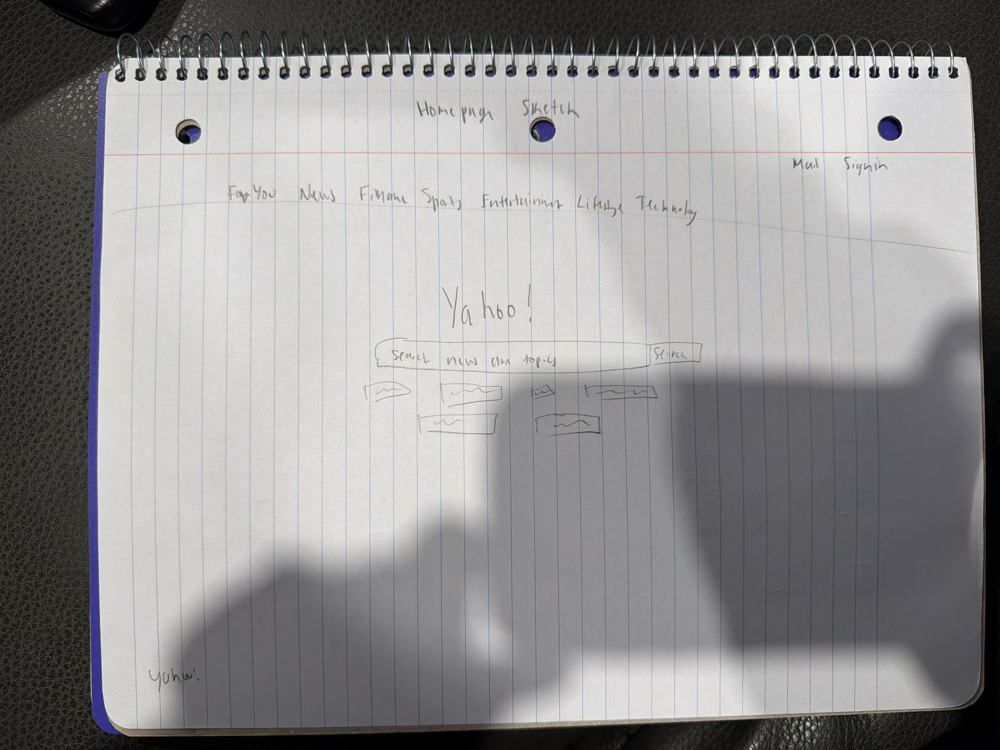
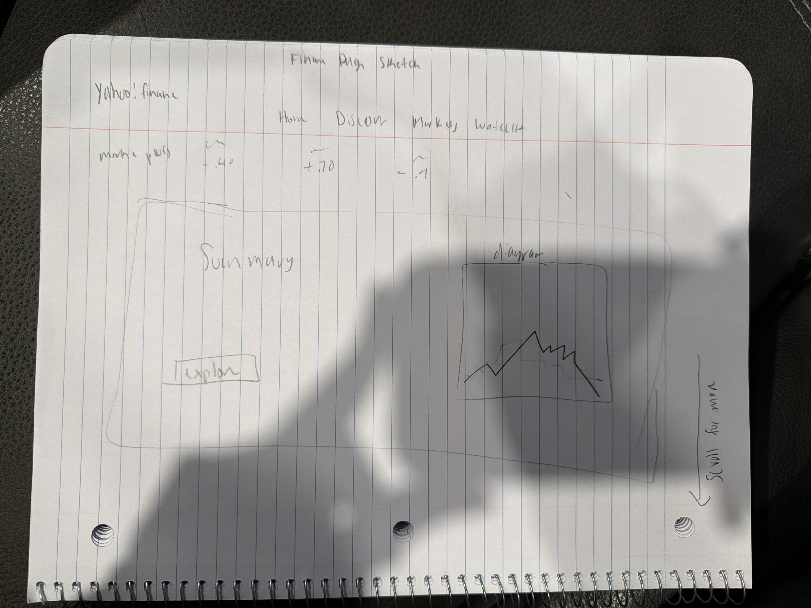
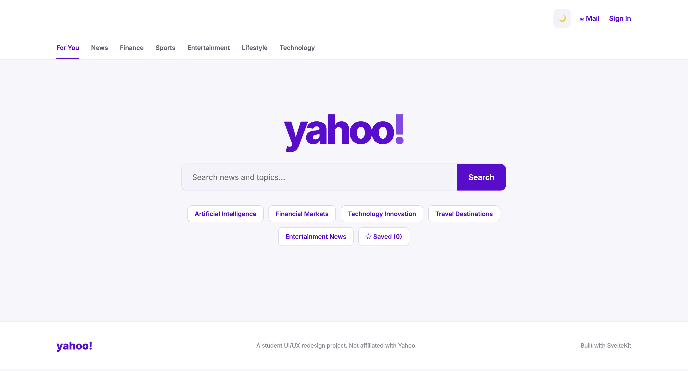
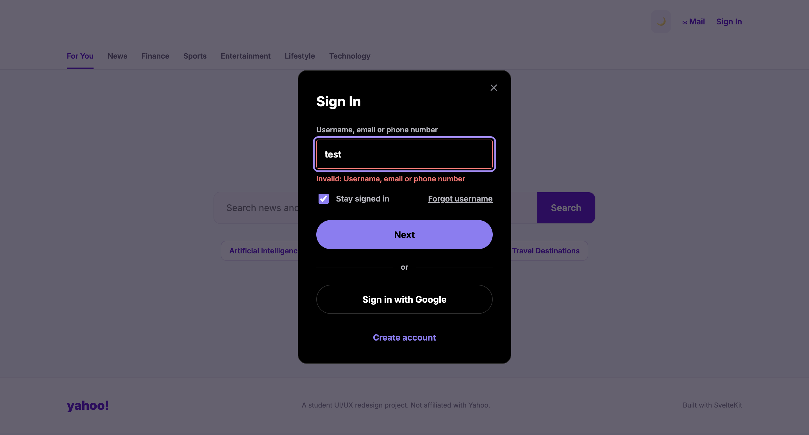
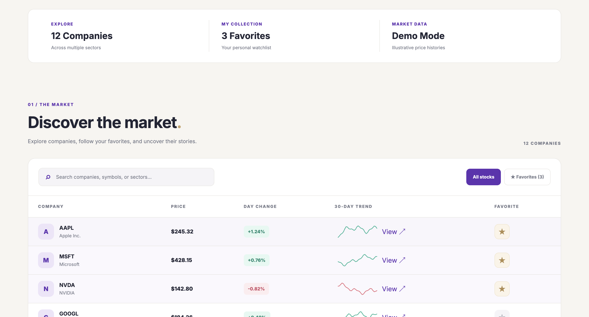
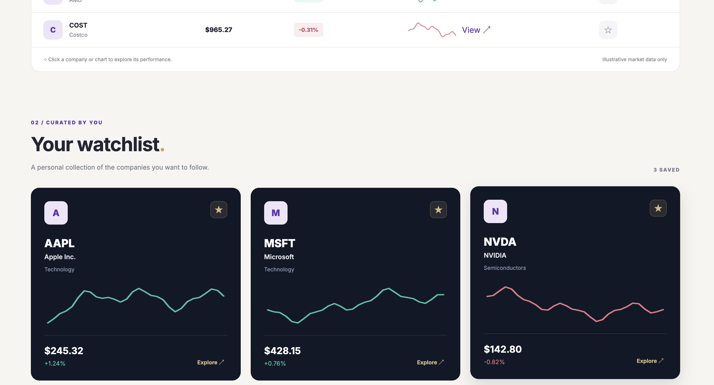
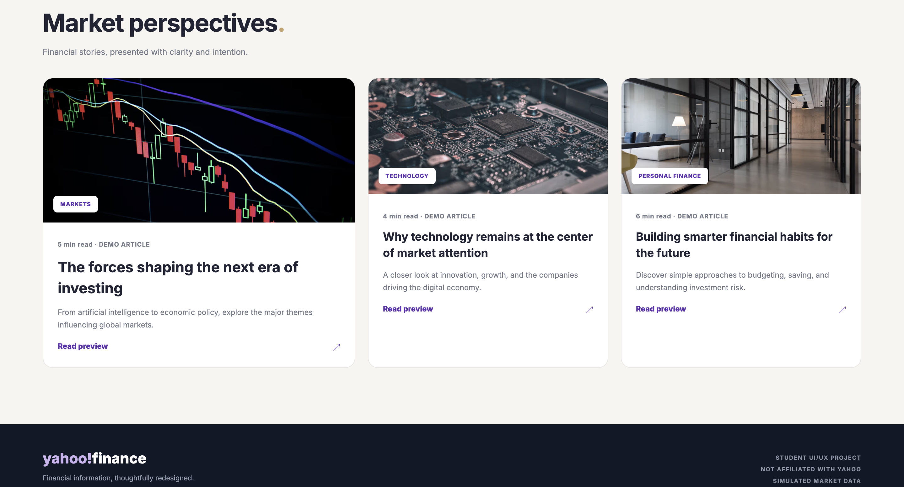
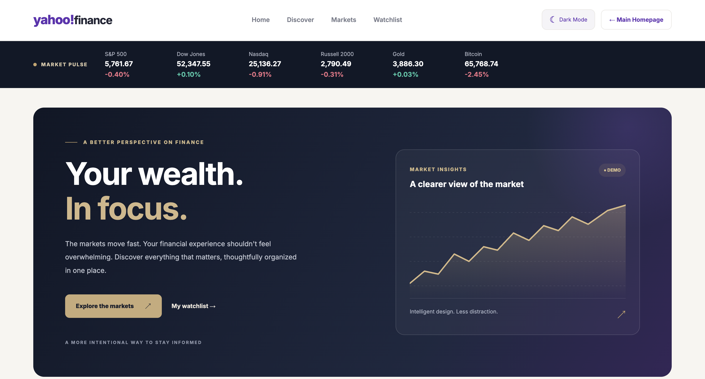
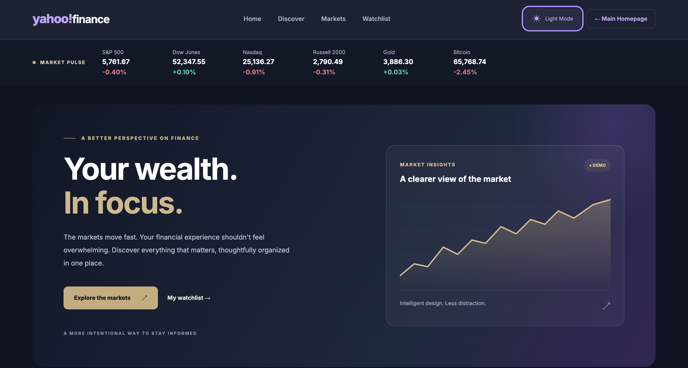

# Yahoo! Redesign — Project 2

**By Salwa Syed, Maria Malik, Aastha Patel, & Priyanshi Kulshrestha**

## About the Project

Yahoo! Redesign is a redesigned user interface for Yahoo, created as a group project for a UI design course. Yahoo is a web portal and search engine originally launched in 1994. It provides a variety of services, including Yahoo Mail, News, Finance, Sports, Weather, and Search, acting as a central hub for information and online services.

For this project, we focused on improving Yahoo's existing interface to make it more organized, easier to navigate, and less overwhelming for users. We chose Yahoo because its homepage combines many different functions, including news stories, advertisements, widgets, and navigation options, which can make the experience feel cluttered.

Our goal was to simplify the interface while keeping the main services and functionality that Yahoo already offers.

Some of the main areas we worked on include:
- Simplifying the landing page and making the search engine the main focus.
- Improving the sign-in experience and making error messages easier to understand.
- Revamping the Finance tab and its layout.
- Maintaining the existing news experience while making it part of the redesigned interface.

## Design Work

### Why Yahoo?

We chose Yahoo because its existing interface presented several usability issues that we wanted to explore and improve. While Yahoo offers many useful services, having so many different features competing for attention can make the website difficult to navigate.

Some of the main issues we identified were:

- **Too Many Competing Functions:** The homepage displays several different services and types of content at once.
- **Overwhelming Interface:** The amount of information and visual elements can make it difficult for users to focus on what they are looking for.
- **Conflicting Priorities:** Different sections, advertisements, and navigation options compete for the user's attention.

### Research and Evaluation

To identify areas for improvement, we used two research methods: heuristic evaluation and background research. These helped us identify usability issues in Yahoo's existing interface and determine which areas of the design needed the most attention.

#### Heuristic Evaluation (Research Method 1)

We evaluated Yahoo using usability heuristics to identify issues with its interface and user experience.

| Usability Heuristic | Issue Identified | Severity |
|---|---|---|
| Aesthetic and Minimalist Design | The homepage displays news, trending topics, tickers, and advertisements all at once, with no clear primary action. | High |
| Match Between System and Real World / Visibility | Sponsored items can look like regular articles or search results, causing users to accidentally click advertisements. | High |
| Consistency and Standards | Yahoo Mail, Finance, News, and Sports each have different navigation and layouts. | Medium |
| Recognition Rather Than Recall | Some Yahoo Mail toolbar icons are unlabeled and require users to hover over them to understand their purpose. | Medium |
| Error Prevention | Misclicks on advertisements and accidental folder moves can happen easily, with little confirmation. | Medium |
| Help Users Recover From Errors | Error messages such as "something went wrong" do not clearly explain the issue or how to fix it. | High |
| Flexibility and Efficiency of Use | Sign-in and verification loops can slow down returning users. | Medium |
| User Control and Freedom | Consent and sign-in pop-ups can block the page before users are able to start their task. | Medium |

#### Background Research (Research Method 2)

We also researched usability principles and guidelines from the Nielsen Norman Group to better understand the issues we identified.

**Aesthetic and Minimalist Design**

Source: https://www.nngroup.com/articles/aesthetic-minimalist-design/

This research explains how unnecessary information and visual elements can make an interface harder to use. Important information should stand out, and elements that do not support the user's main task should not distract from it.

**Error-Message Guidelines**

Source: https://www.nngroup.com/articles/error-message-guidelines/

This research focuses on making error messages clear and helpful. Error messages should use understandable language, explain what went wrong, and give users enough information to understand how to move forward.

### Key Findings

Through our evaluation and background research, we identified a few main areas that could be improved.

**1. Excessive Visual Clutter and Redundant Navigation**

- Too many elements compete for the user's attention.
- Poor visual hierarchy makes it difficult to identify the most important parts of the page.
- Advertisements and other content distract from the main purpose of the website.
- Limited white space makes the interface feel crowded.
- Duplicate navigation options and unnecessary redundancy make the experience more complicated.
- The amount of information displayed increases cognitive load.

**2. Vague Error Messages and Sign-in/Verification Loops**

- Error messages do not always clearly explain what went wrong.
- Users may not know how to recover from an error or what to do next.
- Repetitive sign-in and verification steps interrupt the user's experience.
- Taking users to a separate sign-in page can interrupt what they were originally doing.

## Initial Sketches and Feedback

Before implementing the redesign, we created two basic sketches to plan the layout and organization of the homepage and Finance page. These sketches helped us visualize how we wanted the redesigned interface to look before moving into implementation.

### Sketches

<table>
  <tr>
    <td align="center">
      <strong>Homepage Sketch</strong> 
      
    </td>
    <td align="center">
      <strong>Finance Page Sketch</strong> 
      
    </td>
  </tr>
</table>

### Feedback

We shared our sketches and received the following feedback:

- The redesigned homepage looks much less crowded compared to the current Yahoo interface and is easier on the eyes.
- The text at the top of the homepage could be smaller and does not need to take up the entire width.
- A light/dark mode option with a toggle button would be a useful addition.
- The Finance page looks great, especially the idea of showing a summary when users first land on the page and allowing them to scroll for more detailed information.

### Changes and Considerations Based on Feedback

We incorporated the suggestion for a light/dark mode option by adding a toggle that allows users to switch between the two themes. We also considered the feedback about keeping the homepage simple and making the Finance page easy to navigate, with an overview available before users explore more detailed information.

### Redesign Decisions and Approach

Based on our findings, we focused on simplifying the landing page, improving the sign-in experience, and revamping the Finance section.

**1. Simplified Landing Page**

One of our main changes was reducing the amount of content displayed on Yahoo's landing page. Instead of having multiple sections, news stories, and other elements competing for attention, we made the search engine the main focus. This creates a much cleaner interface and makes it easier for users to immediately understand the primary purpose of the page.

  

**2. Improved Sign-in Experience and Error Messages**

We also made changes to the sign-in process to make it less disruptive and easier to understand. Instead of taking users to a separate sign-in page, the sign-in experience now appears in a pop-up. This allows users to sign in without leaving the page they were already on.

We also improved the error messages to make it clearer when something goes wrong. For example, instead of displaying a vague error, the interface now provides the message **"Invalid: Username, email or phone number."** This gives users a better understanding of what the issue is.

  

**3. Revamped Finance Tab**

We redesigned the Finance section to give it an updated layout and improve the way financial information is presented. This was another major area of focus in our redesign. We also added interactive features to make the Finance page easier to navigate and explore. The buttons in the initial summary section act as shortcuts to different sections of the page. For example, clicking **Explore the Market** takes users directly to the Discover the Market section, while clicking **My Watchlist** takes them to their watchlist.

Within the market section, users can click the star icon next to a company to add it to their watchlist. They can also click on a company's name in either the market or watchlist section to expand its information and view more details.

  
  

  
  

**4. News, Sports, Entertainment, Lifestyle, and Technology Pages**

We included tabs on the homepage for News, Sports, Entertainment, Lifestyle, and Technology, which lead to their respective pages. However, these pages are currently placeholders and have not been fully developed. They share a similar layout and do not yet have much differentiation in their content or design. This is an area that could be expanded in the future to give each category its own more distinct experience.

**5. Light and Dark Mode**

We also implemented a light and dark mode option that allows users to switch between different themes.

  
  

## Project Demo

**Video Demo:** [Watch our project demo](https://drive.google.com/file/d/1BLMcUFpPelHPQUrSFI0_aIewel7-RMVm/view?usp=sharing)

## Source Code and Live Application

- **GitHub Repository:** [View the source code](https://github.com/salwasyedd/ui-design-portfolio)
- **Live Application:** [Visit the Yahoo Redesign](https://yahoo-redesign-one.vercel.app/)
